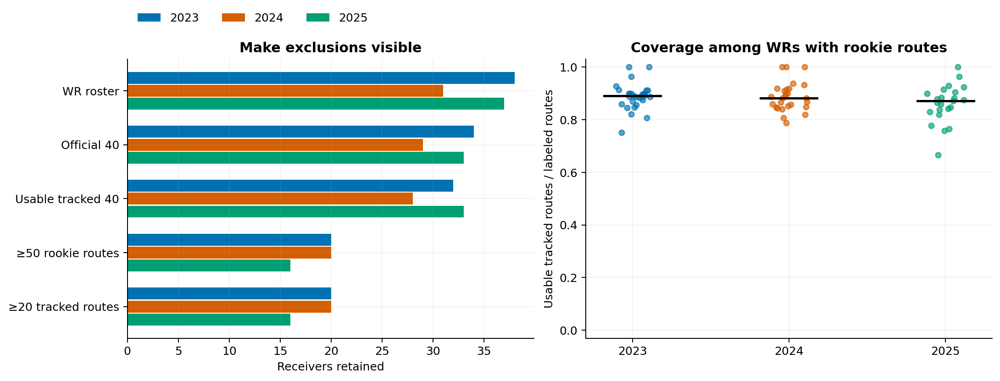
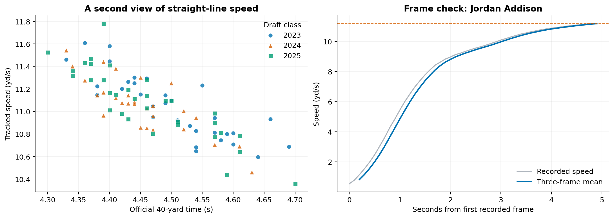
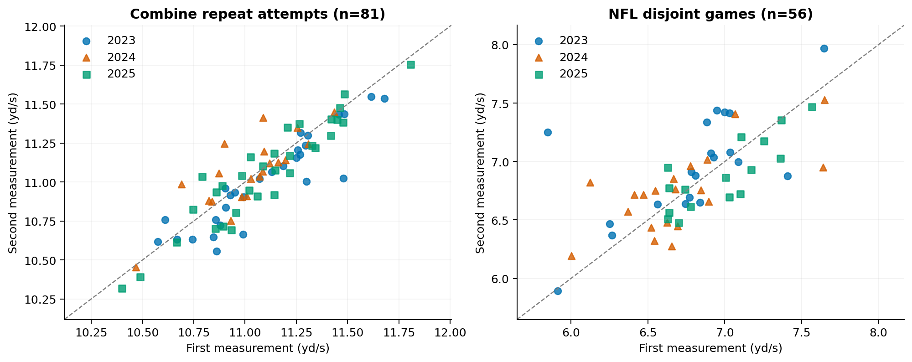
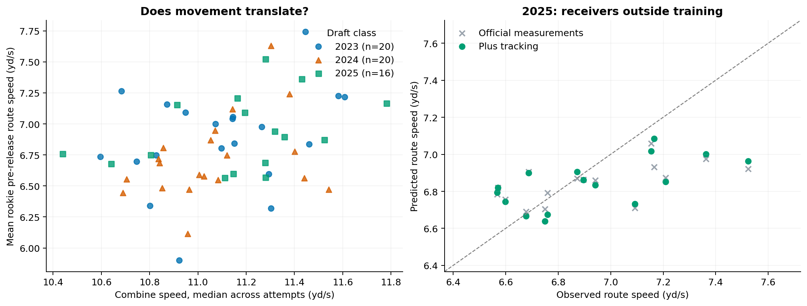
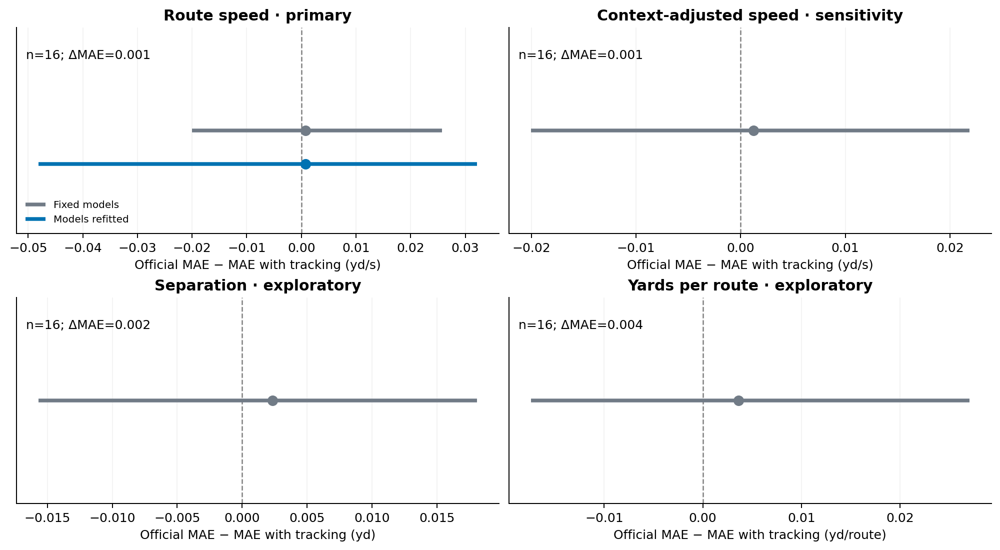

# What the study found

Tracked Combine speed was repeatable and associated with rookie route speed, but it added little predictive value beyond official measurements in this study. For 16 receivers in the 2025 holdout, mean absolute error fell from 0.1929 to 0.1921 yards per second (yd/s). The reduction was 0.0007 yd/s, or 0.38%. A 95% bootstrap interval that refitted both models ranged from -0.0481 to 0.0321 yd/s and included zero.

The practical finding is limited: this particular tracking feature has not shown a clear incremental benefit for estimating receiver route speed. It offers a reproducible starting point for studying where Combine movement carries into NFL play.

# Research question

Does a receiver's sensor-measured speed during the Combine 40-yard dash add information beyond the official time when estimating how fast that receiver moves on NFL routes?

I built a notebook linking Combine tracking to movement during a player's draft-year NFL regular season. The football question is whether scouts gain useful information about game movement by examining sensor speed alongside the stopwatch.

# Population and exposure

The analysis focuses on wide receivers in the 2023–2025 draft classes. Each player contributes one observation, using only regular-season games in that player's draft year. This gives every class the same season-length opportunity window; it avoids comparing several years of one player's career with a single season for another.

The study requires an official 40 time, usable Combine tracking, at least 50 labeled rookie routes, and at least 20 routes with usable game tracking. Nullified plays and unlabeled routes are excluded. Of 106 receivers in the supplied player roster, 56 qualified: 20 from 2023, 20 from 2024, and 16 from 2025. The largest reduction after matching Combine measurements came from the minimum-route requirement.

*Figure 1. Counts show cumulative selection. Coverage is usable tracked routes divided by labeled rookie routes among receivers with routes. Class medians were 89.1%, 88.2%, and 87.1%; these medians describe that broader group, rather than only the final 56-player cohort.*

# Measuring speed from tracking

For each valid Combine attempt, I calculate the highest mean speed over three consecutive frames. I then take the median across that player's attempts. This reduces the influence of a single speed spike without assuming that the recorded clip begins at the official timing gate.

The primary NFL outcome applies the same three-frame calculation within each route's snap-to-pass-release window, then averages those route peaks by player. Speeds are measured in yards per second. Tracks must cover both ends of the window and pass continuity checks. Conflicting duplicate records and incomplete route fragments are excluded.

*Figure 2. The tracked signal captures peak speed, while official time summarizes the full sprint. The example trace illustrates the three-frame mean. It was selected by the smallest player identifier with a valid attempt, independently of the holdout result.*

This outcome measures how much speed appears during the available route window. Separation at release and receiving yards per labeled route are secondary, exploratory outcomes. Separation requires at least 20 measured routes. Unresolved receiving-yard records remain missing instead of being silently counted as zero.

# Testing incremental value

I compare four models on identical players for each outcome: a training-mean baseline, official 40 time alone, official measurements, and official measurements plus tracked Combine speed. The official-measurement model includes the 40 time, 10-yard split, height, and weight when those measurements are available.

The models use ridge regression, which limits coefficient size in a small player sample. Imputation and scaling are fitted on training players, and the regularization setting is fixed before viewing holdout outcomes. Career totals and draft pick are excluded from the predictors.

The main evaluation trains on the 2023 and 2024 classes and holds out 2025. An earlier 2023-to-2024 comparison is reported separately. Leave-one-class-out comparisons are sensitivity checks; those trained on later classes are not presented as forecasting evidence.

# Does the measurement repeat?

The first two valid Combine attempts showed Spearman correlation 0.871 across 81 paired receivers, with a 95% player-bootstrap interval of [0.785, 0.925]. Their mean absolute difference was 0.106 yd/s. This check uses receivers with repeated valid attempts, a broader group than the final study cohort.

For all 56 eligible receivers, I split NFL routes into two disjoint groups of games, keeping every route from one game together. Each player needed at least four games and ten routes in each group. The two speed estimates had correlation 0.701, interval [0.507, 0.835], and mean absolute difference 0.235 yd/s.

*Figure 3. The diagonal marks identical values. Correlation summarizes player ordering; absolute differences show disagreement in speed units. The NFL comparison uses one seeded partition of games, so it does not establish stability across future roles or seasons.*

# Accounting for route context

A route's assignment and time before release can affect the speed a receiver has room to reach. A sensitivity analysis therefore adjusts route speed for route label, release duration, and squared release duration. The context model gives each training player equal total weight. Five folds split by player produce training residuals from models fitted on other players. Holdout expectations use a model fitted on all training players. Player averages of the residuals form the adjusted outcome.

# Results from the official competition data

The final evaluation used 40 training receivers and 16 holdout receivers. Each row below evaluates the same holdout players. Lower errors are better.

| Model | MAE (yd/s) | RMSE (yd/s) |
|---|---:|---:|
| Training mean | 0.2505 | 0.3132 |
| Official 40 time only | 0.2360 | 0.3012 |
| Official measurements | 0.1929 | 0.2536 |
| Official measurements + tracking | 0.1921 | 0.2425 |

Official measurements improved on the training-mean and 40-only baselines. Adding tracking reduced MAE by just 0.0007 yd/s. The conditional 95% interval, holding fitted models fixed, was [-0.0200, 0.0257]. The wider refit interval, [-0.0481, 0.0321], used 500 draws that resampled training players within class, refitted preprocessing and both models, and independently resampled holdout players. Both intervals include zero. The result is inconclusive, rather than evidence that tracking can never help.

*Figure 4. Each point represents a receiver. Tracked Combine speed and rookie route speed had pooled Spearman correlation 0.364. That descriptive relationship alone does not establish improvement beyond the baseline. Holdout predictions from the two models are similar.*

The context-adjusted outcome told the same broad story. MAE fell from 0.1590 to 0.1577 yd/s, with conditional reduction interval [-0.0200, 0.0219]. The earlier 2023-to-2024 comparison also showed a small primary MAE reduction, from 0.2629 to 0.2602 yd/s. It provides a second observed class comparison, not a precise estimate of future benefit.

*Figure 5. Positive differences favor tracking. Gray intervals condition on the fitted models; the blue primary interval also refits them. Every displayed interval crosses zero. Axes use the units of each outcome.*

Exploratory reductions were 0.0023 yards for separation and 0.0036 yards per route for receiving production, also with conditional intervals crossing zero. For yards per route, both measurement models performed worse than the training-mean baseline. These results do not support a claim that the feature improves receiver-production forecasts.

# Football application

The current evidence does not justify increasing a prospect's evaluation solely because of this tracked peak-speed feature. The signal is repeatable, but its additional holdout benefit is small and uncertain.

A useful next application is a film-review queue for prospects whose sensor speed and stopwatch disagree. Scouts could examine acceleration, release technique, and route opportunities behind that disagreement, then evaluate any additional features on a new class. This study does not test whether such a queue improves scouting decisions. It also does not establish a causal or complete measure of receiver value.

# Limitations and reproducibility

Combine participation, minimum-route requirements, injury, and playing opportunity select the study population. Route labels and release duration cannot capture every coverage, quarterback, or team effect. Separation may be selectively measured. Only one later class serves as the final holdout, and the player bootstrap does not model dependence between teammates. Speed translation is an association rather than a causal or complete measure of receiver value.

The linked notebook contains extraction, quality checks, cohort accounting, models, uncertainty calculations, and figures. These reported results come from the saved version 4 run using pipeline 3.0.0 and the official competition input. Its output manifest records configuration and hashes. The public repository also includes software checks on generated fixtures; none of those fixtures supplies the findings above.

Notebook: [Executed Kaggle Notebook](https://www.kaggle.com/code/steventeng2022/nfl-big-data-bowl-2027).

Code: [GitHub repository](https://github.com/steventeng2022/Kaggle-NFL-Big-Data-Bowl-2027).

Data: [NFL Big Data Bowl 2027 competition data](https://www.kaggle.com/competitions/nfl-big-data-bowl-2027/data).
